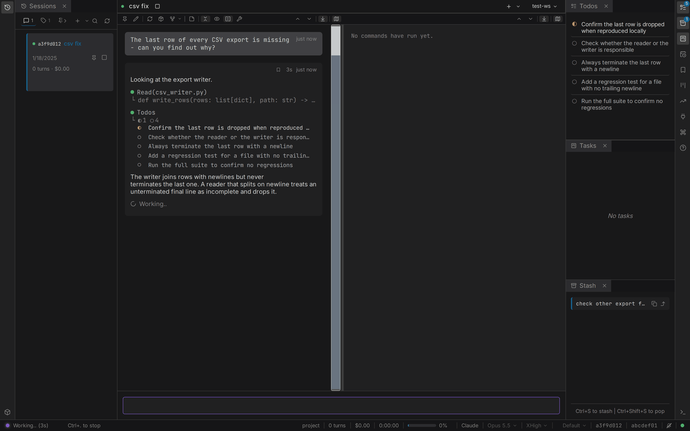

# Claudebox

[](LICENSE) [](pyproject.toml) [](https://jakubro.github.io/claudebox/) [](#)

[Quickstart](#quickstart) · [Using claudebox](#using-claudebox) · [Compared with other tools](#compared-with-other-tools) · [Contributing](#contributing)

**Claudebox is a web UI for AI coding agents that runs every session in its own container.** Claude Code runs through the Claude Agent SDK by default, or any LangChain provider — Ollama, OpenAI, Gemini and more — through LangGraph.



A coding agent on the host with its permission checks bypassed runs every command with its user's access to the whole machine. With the checks on, it stops at each command it has not been allowed and waits for an answer. Claudebox runs the agent with the checks bypassed, inside a disposable container that holds the workspace and little else.

What claudebox does:

- **It gives every session its own container.** A Podman or Docker container, with the workspace mounted at the same path it has on the host. Inside it the agent can run anything; outside the workspace it can write only the workspace's session data, its login and any directory mounted for it. A profile supplies the system prompt, hooks, skills, commands and agents each session starts with.
- **It shows every session in a web UI.** Long sessions fold down to what the agent changed and said, a reply sits beside the sentence it quotes, diagrams and diffs render in place, and the transcript comes with a terminal beside it, a message queue and a phone layout.
- **It lets agents run sessions of their own.** An agent can start other sessions, message them, stop them and read their transcripts, and each one's replies arrive in its conversation as messages. With nested containers it also builds images and runs services inside its own.

## Quickstart

Requires **Podman** or **Docker**, which the installer neither installs nor checks for, plus **Git** and **Bash**. **Python** 3.13+ and **Node.js** 24+ are fetched through [uv](https://docs.astral.sh/uv/) and [nvm](https://github.com/nvm-sh/nvm) when missing.

Install:

```bash
# Podman (default)
curl -LsSf https://raw.githubusercontent.com/jakubro/claudebox/main/bin/install.sh | bash

# Docker
curl -LsSf https://raw.githubusercontent.com/jakubro/claudebox/main/bin/install.sh | CLAUDEBOX_BACKEND=docker bash
```

The first install builds the container image from scratch, which takes 5-15 minutes depending on network and CPU. The installer clones the library, builds the frontend and the image, installs the `claudebox` CLI and the `claudeboxd` daemon, registers the daemon as a systemd user service, and adds a daily maintenance timer that updates claudebox, rebuilds the image and prunes old sessions.

Log in once:

```bash
claudebox run
```

The first launch opens Claude Code's terminal interface to log in. The login persists per workspace, or globally when the project has no `.workspace` marker, and from then on sessions run in the terminal through `claudebox run` or in the web UI. To log in without the terminal interface, run `claudebox run -- claude auth login`, paste the code at its prompt, which shows nothing while it is pasted, and press `Enter`.

Then open [https://localhost:41820](https://localhost:41820). `claudeboxd` serves the web UI there behind Caddy with a self-signed certificate, so the browser shows a one-time certificate warning, which is safe to accept. A message sent from the box at the bottom creates a session and starts its container.

On a system without systemd — macOS, for instance — the daemon service is not installed; start it with `claudeboxd`. [Troubleshooting](https://jakubro.github.io/claudebox/guide/troubleshooting/) covers a step that fails.

## Using claudebox

The full documentation is on [the claudebox site](https://jakubro.github.io/claudebox/). [Start here](https://jakubro.github.io/claudebox/start/) covers installation, a first session, where the files land and removal; the [CLI reference](https://jakubro.github.io/claudebox/reference/cli/) lists every verb and flag, the [configuration reference](https://jakubro.github.io/claudebox/reference/configuration/) every settings key, [keyboard shortcuts](https://jakubro.github.io/claudebox/reference/shortcuts/) every binding, and the [specification](https://jakubro.github.io/claudebox/spec/) the full user-facing behavior.

### What claudebox does to the host

- **It installs a CLI, a daemon and a maintenance timer.** `claudebox` and `claudeboxd` link into `~/.local/bin`, the daemon runs as a systemd user service, and once a day the timer updates claudebox, rebuilds the image and prunes what old sessions leave behind. Sessions, settings, the profile and logs live under `~/.claudebox/`, or under `{project}/.claudebox/` for a project with a `.workspace` marker. [Start here](https://jakubro.github.io/claudebox/start/) lists every path and the commands that remove them.
- **It gives a container the workspace and little else.** The workspace is mounted read-write. Beyond it, a container writes the data of every session in the workspace, the agent's login and whatever `[mounts]` adds. The claudebox library, the profile and the workspace's own settings file are mounted read-only.
- **It serves the web UI on every interface, without authentication.** Anyone who can reach port 41820 can drive every session. On an untrusted network, firewall the port or put an authenticating proxy in front of it. The [security guide](https://jakubro.github.io/claudebox/guide/security/) covers what is mounted, what is published and what is read-only.
- **It pins what it downloads and sends no telemetry.** The host binaries the installer downloads and the image's tools are fetched at versions and checksums recorded in the repository; `claude-code`, the agent's Python packages and the image's system packages follow upstream by design.

### Features

- **Long sessions.** Turns fold, a minimap replaces the scrollbar, and the Focused view leaves out the calls that only read, leaving what the agent changed and said. [Chat](https://jakubro.github.io/claudebox/features/chat/)
- **Sessions waiting for an answer.** A session blocked on a question shows the agent's one-line reason in the sessions list, turns its tab's icon red, and can offer up to five one-click replies. [Chat](https://jakubro.github.io/claudebox/features/chat/)
- **Threads.** Any quoted span takes a reply beside it, and that reply can be asked on its own without touching the conversation. The conversation forks at any message. [Threads](https://jakubro.github.io/claudebox/features/threads/)
- **Rendering.** Mermaid diagrams, GeoJSON maps, STL models, GitHub callouts, math and word-level diffs render in place. [Rendering](https://jakubro.github.io/claudebox/features/rendering/), [Diagrams, maps and models](https://jakubro.github.io/claudebox/features/diagrams/)
- **Panels.** Todos, tasks, scheduled prompts, bookmarks, boards, usage, logs and more dock around the chat. [Panels](https://jakubro.github.io/claudebox/features/panels/)
- **Boards.** A `board.yaml` and its ticket files draw as a kanban board, and dropping a ticket into an active column starts a session on it. [Boards](https://jakubro.github.io/claudebox/features/boards/)
- **Sessions started by agents.** An agent can start sessions of its own, message, stop and read them, and receives each reply as a message; with nested containers it builds images and runs services inside its own. [Many sessions](https://jakubro.github.io/claudebox/features/multi-session/), [Nested containers](https://jakubro.github.io/claudebox/features/nested-containers/)
- **Ports to this computer.** An agent asks to open a port it serves on - a dev server, a preview - and the request is approved or rejected on a card in the conversation; an approved port is reachable from this computer only. [The container boundary](https://jakubro.github.io/claudebox/features/container-boundary/)
- **Session bundles.** A settings bundle starts a session on its own model, effort, session prompt, environment and opening messages. [Configuration](https://jakubro.github.io/claudebox/guide/configuration/)

### Configuration

Settings live in `.claudebox/settings.toml`. Claudebox walks up from the working directory, then reads `~/.claudebox/settings.toml`, and merges every file it passes; the nearest wins on a key two files share. Every key is in the [configuration reference](https://jakubro.github.io/claudebox/reference/configuration/). A `.workspace` marker keeps a project's sessions and login apart ([workspaces](https://jakubro.github.io/claudebox/guide/workspaces/)), a profile sets what each session starts with ([profiles](https://jakubro.github.io/claudebox/guide/profiles/)), and the runtime is Claude Code or LangGraph ([runtimes](https://jakubro.github.io/claudebox/guide/runtimes/)).

## Compared with other tools

### Closest neighbours

| Project | What it does | How claudebox differs |
|---|---|---|
| [RchGrav/claudebox](https://github.com/RchGrav/claudebox) | Claude Code's terminal interface in a Docker container, with a slot per concurrent session, per-project development profiles and a firewall allowlist | A separate project with the same name. Claudebox serves its sessions in a web UI, on Podman or Docker, and also runs LangGraph providers |
| [Claude Code dev containers](https://docs.claude.com/en/docs/claude-code/devcontainer) | Claude Code installed in a project's dev container, with the repository bind-mounted and the editor attached from the host | A dev container is configured in the repository and shared by every session in it. Claudebox starts a container per session from its own image, with nothing added to the repository |
| [CloudCLI](https://github.com/siteboon/claudecodeui) | A web and mobile UI over Claude Code, OpenCode, Cursor CLI and Codex sessions. Self-hosted, the agent runs on the host; an experimental mode runs it in a microVM sandbox | Every claudebox session runs in its own container, and nothing is hosted |
| [container-use](https://github.com/dagger/container-use) | An MCP server that gives an agent a fresh container in its own git branch for each environment | The agent stays on the host and reaches its container through tools. Claudebox runs the agent itself inside the container |

### What claudebox is not

- **Not a hosted or multi-user service.** It runs on one machine for one user. The daemon has no access control of its own, and users of one host are isolated from each other only as far as rootless Podman isolates them.
- **Not a guard on the workspace or the network.** Inside its container the agent reads and writes the whole workspace, the other sessions' data included, reaches the network and installs packages. The container keeps it off the rest of the host.
- **Not an agent.** It runs Claude Code through the Claude Agent SDK, or a LangChain provider through LangGraph, each on its own login or API key.

## Contributing

```bash
git clone https://github.com/jakubro/claudebox.git
cd claudebox
just install          # python + frontend + e2e deps
just check            # full pre-commit (lint + test)
just --list           # all recipes, grouped
```

Coding conventions, testing patterns and the development workflow are in [`docs/GUIDELINES.md`](docs/GUIDELINES.md), the subsystems in [`docs/ARCHITECTURE.md`](docs/ARCHITECTURE.md), and the interactive test harness in [`docs/TEST-UI.md`](docs/TEST-UI.md). Every development command runs from the repository root through the [justfile](justfile).

## Built with

Claudebox is built on these projects:

- **Agent runtimes** — [Claude Code](https://github.com/anthropics/claude-code), [Claude Agent SDK](https://docs.anthropic.com/claude/docs/agent-sdk), [LangGraph](https://langchain-ai.github.io/langgraph/), [LangChain](https://www.langchain.com/), [Model Context Protocol](https://modelcontextprotocol.io/), [Ollama](https://ollama.com/)
- **Interface** — [React](https://react.dev/), [Vite](https://vite.dev/), [Dockview](https://dockview.dev/), [dnd kit](https://dndkit.com/), [Floating UI](https://floating-ui.com/), [TanStack Virtual](https://tanstack.com/virtual), [Lucide](https://lucide.dev/)
- **Typefaces** — [Inter](https://rsms.me/inter/), [JetBrains Mono](https://www.jetbrains.com/lp/mono/), [DejaVu](https://dejavu-fonts.github.io/)
- **Rendering** — [react-markdown](https://github.com/remarkjs/react-markdown), [remark/rehype](https://unifiedjs.com/), [Mermaid](https://mermaid.js.org/), [KaTeX](https://katex.org/), [highlight.js](https://highlightjs.org/), [react-syntax-highlighter](https://github.com/react-syntax-highlighter/react-syntax-highlighter), [DOMPurify](https://github.com/cure53/DOMPurify), [jsdiff](https://github.com/kpdecker/jsdiff), [Leaflet](https://leafletjs.com/), [three.js](https://threejs.org/)
- **Backend** — [FastAPI](https://fastapi.tiangolo.com/), [Starlette](https://www.starlette.io/), [Uvicorn](https://www.uvicorn.org/), [HTTPX](https://www.python-httpx.org/), [Pydantic](https://docs.pydantic.dev/), [structlog](https://www.structlog.org/), [Rich](https://github.com/Textualize/rich), [ruamel.yaml](https://sourceforge.net/projects/ruamel-yaml/), [tree-sitter](https://tree-sitter.github.io/tree-sitter/)
- **Container and toolchain** — [Podman](https://podman.io/), [Docker](https://www.docker.com/), [Ubuntu](https://ubuntu.com/), [Bubblewrap](https://github.com/containers/bubblewrap), [mise](https://mise.jdx.dev/), [uv](https://docs.astral.sh/uv/), [nvm](https://github.com/nvm-sh/nvm), [Node.js](https://nodejs.org/), [just](https://just.systems/), [Caddy](https://caddyserver.com/)
- **Testing and quality** — [Playwright](https://playwright.dev/), [Vitest](https://vitest.dev/), [pytest](https://docs.pytest.org/), [Biome](https://biomejs.dev/), [Ruff](https://docs.astral.sh/ruff/), [ty](https://github.com/astral-sh/ty), [Knip](https://knip.dev/), [jscpd](https://github.com/kucherenko/jscpd)

## License

Copyright (C) 2025-2026 Jakub Roman. Distributed under the [GNU GPL v3](LICENSE).

Third-party licenses and the notices that must accompany a redistributed build are recorded in [NOTICE.md](NOTICE.md).
