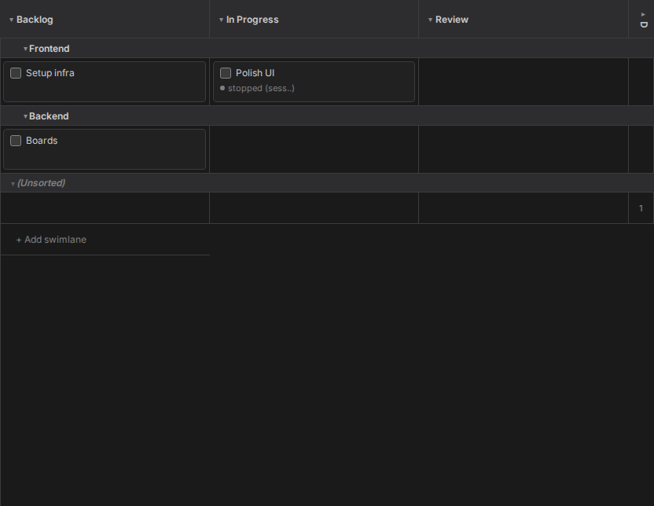
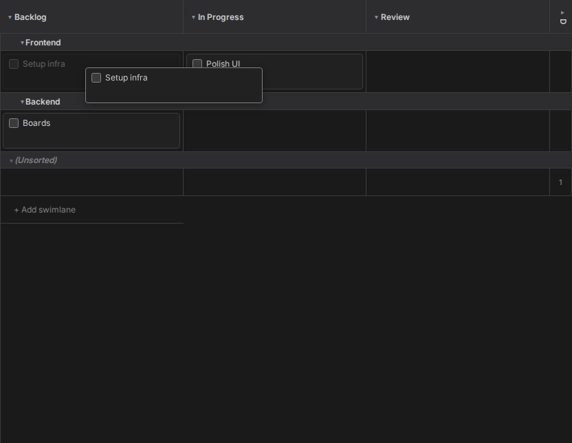
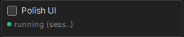

# Boards

A board is a `board.yaml` file in the repository, and the tickets on it are markdown files next to it. Claudebox finds them, draws them as a kanban board, and writes changes straight back to disk, so the board can be reviewed and diffed like any other file.

Dragging a ticket into an active column starts a session on it.

## Where a board comes from

Any `board.yaml` in the workspace becomes a board. Two things are derived from where it sits:

- **Its id** is the directory holding it, relative to the workspace root, with slashes turned into hyphens - `planning/roadmap/board.yaml` becomes `planning-roadmap`. A `board.yaml` at the workspace root is `root`. That id is what appears in the URL, so a board is deep-linkable.
- **Its name** is the board's own `name:` key, falling back to the name of the directory holding it. Renaming it inline from the Boards panel writes the key.

A ticket's card title comes from the first `#` heading in its file, falling back to the filename.

## Moving a ticket moves the file

Each column declares a folder - a directory under the one holding `board.yaml`, so `folder: tickets/active/` beside a `tickets/active/` directory - and columns may share one. Dragging a card to a column with a different folder rewrites `board.yaml` and relocates the ticket file into that folder, under a lock, atomically; between columns sharing a folder only `board.yaml` changes. A card whose file is not in its column's folder stays put, and the footer says why. Dragging between swimlanes reassigns the swimlane without moving anything.

Cards also reorder within a cell, and a card dropped between two others lands at that position. `Ctrl`-click multi-selects, and the whole selection drags together. A card dropped onto a column header changes column and keeps its swimlane. Terminal columns start collapsed and still accept drops.

Columns and swimlanes are editable in place: double-clicking a header renames it, the button at the bottom of the board creates a swimlane, dragging or the context menu reorders either axis, and deleting a swimlane moves its tickets to `(Unsorted)`. Renaming a column changes its display label only - folders and ticket files stay where they are.

## Active columns

Moving a ticket into a column marked active in `board.yaml` creates a session for that ticket, if it does not already have one. The board's configured prompt sequence is then delivered to that session as its opening messages, with `{ticket}` replaced by the ticket's path.

A multi-selection moved in shares one session, with `{ticket}` expanding to the whole list.

The card then carries that session's status dot, in the colours a Sessions panel row uses - dark orange, for instance, when the agent working the ticket needs you. Everything stays in step across every browser tab looking at the same board, and an open board shows edits made to `board.yaml` or to a ticket file on disk within a few seconds, whoever made them.

## Related pages

- [Boards panel and ticket board](../SPEC.md#6-boards-panel--ticket-board) - the full behavior contract
- [Panels](panels.md) - where the Boards panel sits
