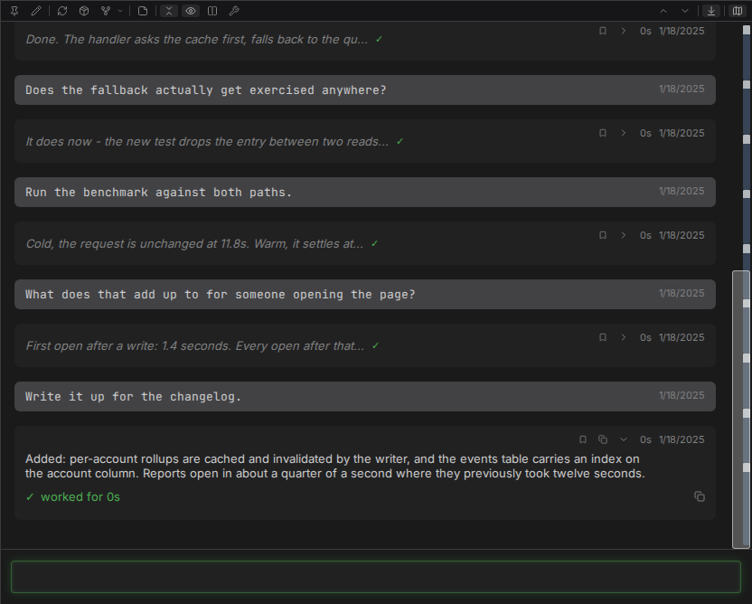
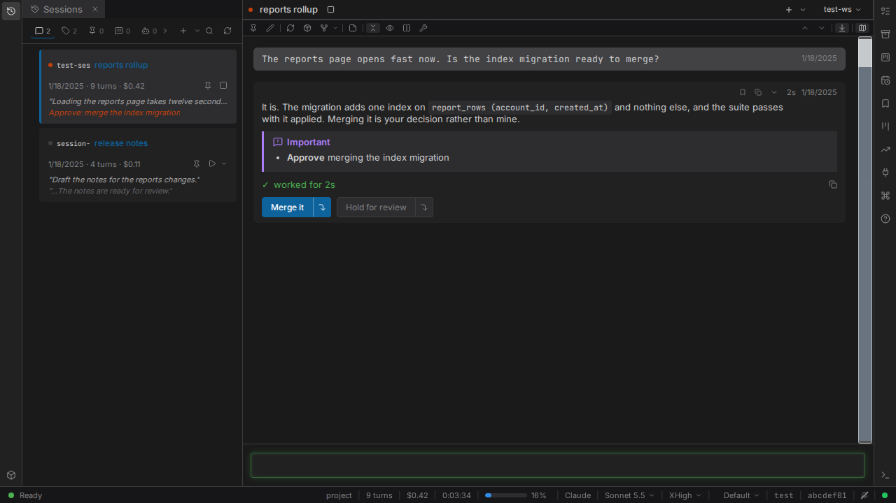
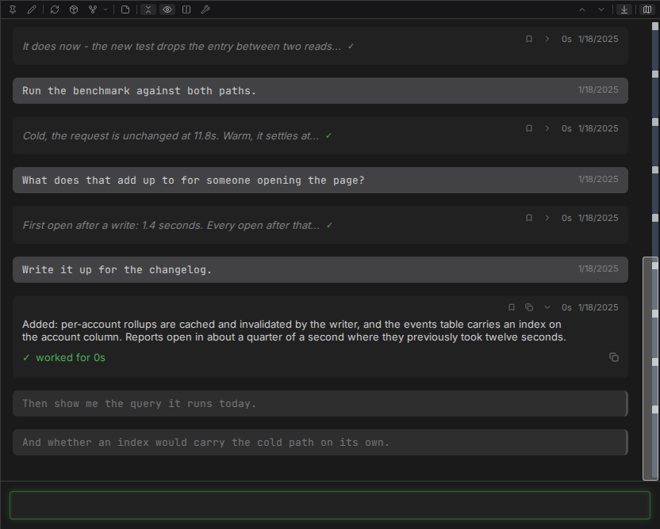
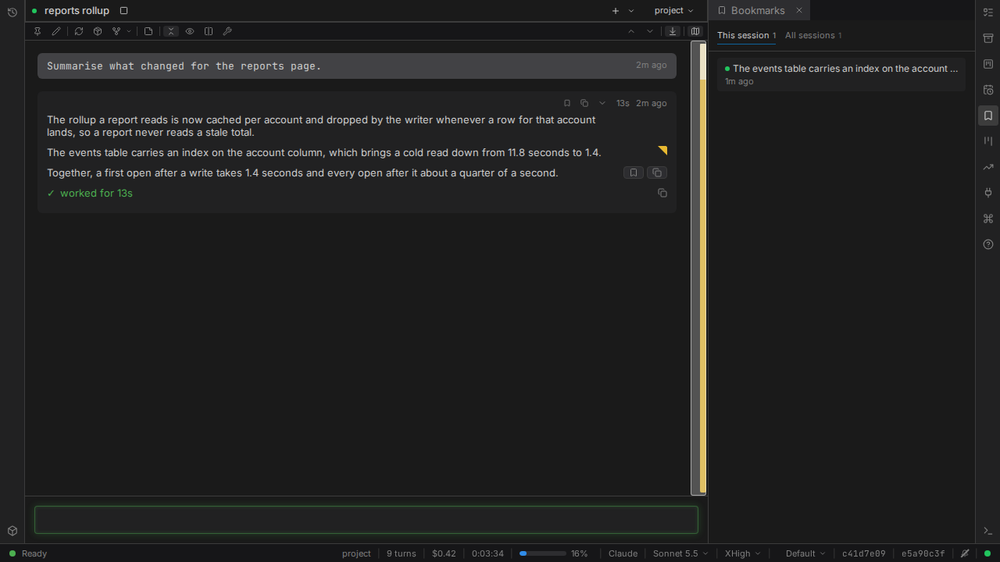
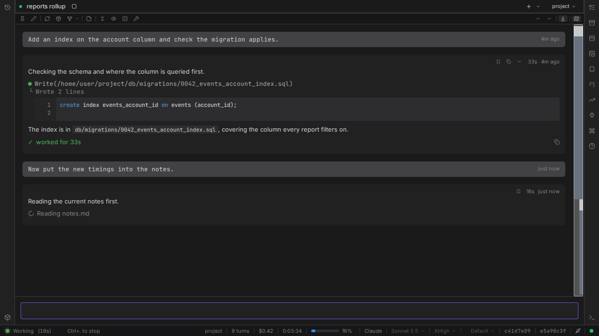
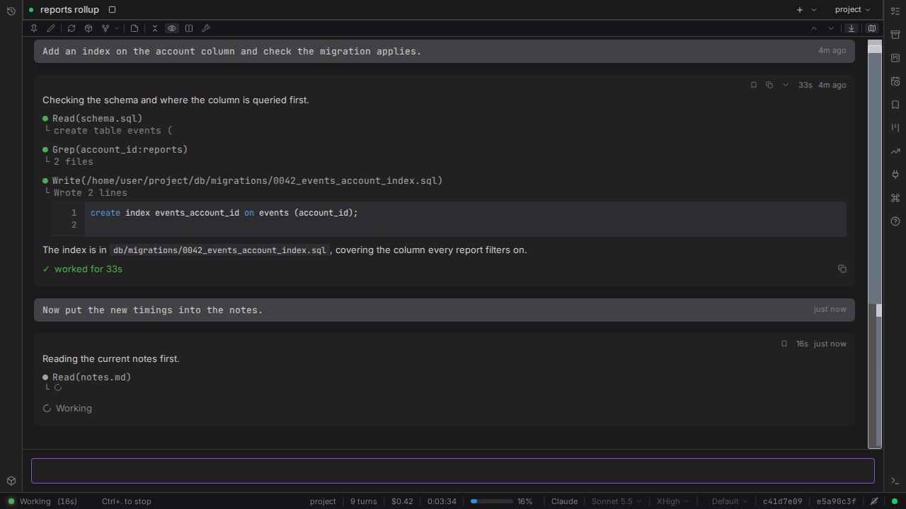
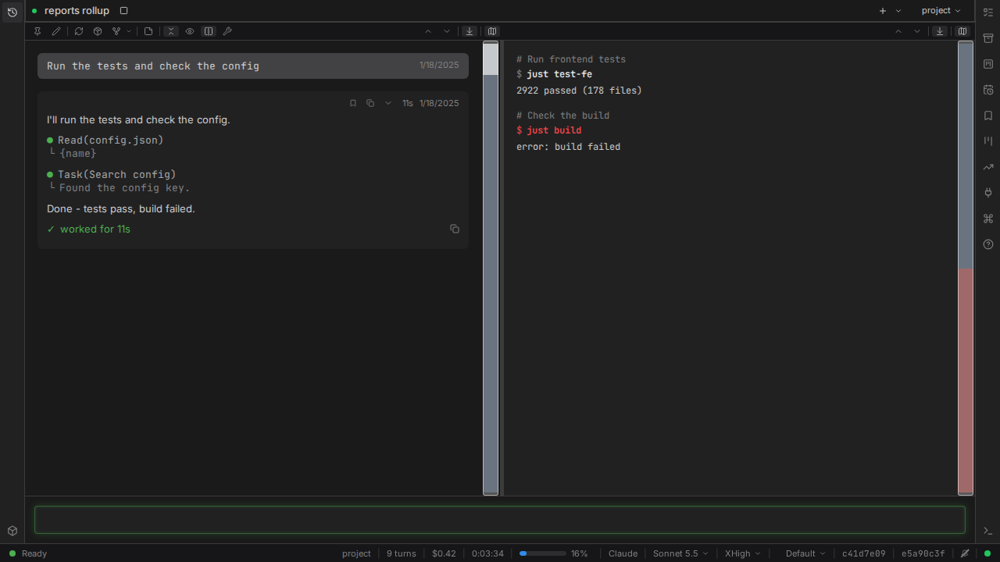
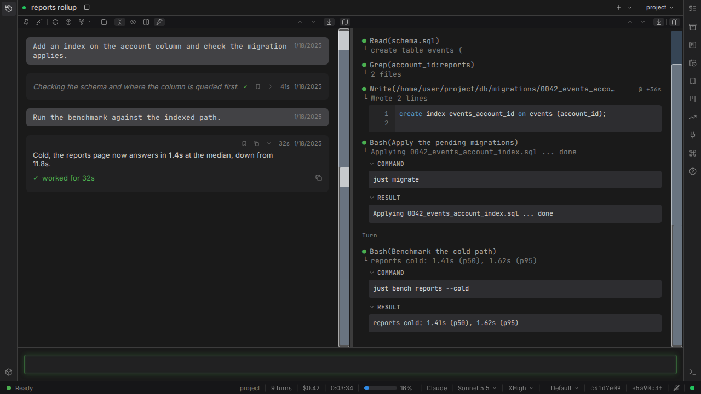
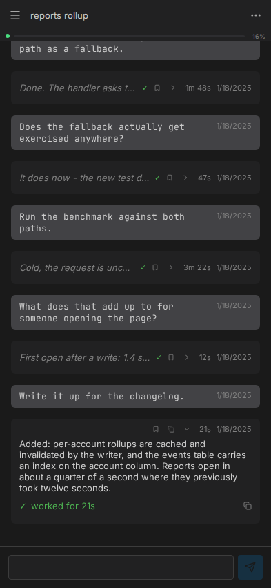

# Chat

The chat shows a session's conversation, with controls for finding a place in a long one.

## Collapsing turns

Each exchange is a turn, and clicking its header collapses it. Collapsed, it keeps the full human message and the first line of the reply, so the transcript reads as a list of the questions asked. Browser find still reaches inside a collapsed turn.

Auto-collapse keeps only the newest turn open and folds the rest as they age. A turn opened by hand stays open as new ones arrive.

A finished turn ends on a green ✓ and how long it worked for, a failed one on a red ✗ beside its red edge; hovering the time shows the clock time it ended, and every user message shows when it was sent. That time is the one the agent recorded for the turn, so a session's turns add up to the footer's total. While a turn runs, its header and the footer count up its time from the moment its message was sent.

## The minimap

In place of a scrollbar, beside the transcript, is a proportional overview of the whole conversation: one segment per compaction period, one sub-bar per turn, sized by how much the turn actually rendered and how long it took. White marks show human messages; yellow ones show bookmarks. Clicking or dragging anywhere on it moves the transcript there.

`Alt+Up` and `Alt+Down` step between human messages relative to what is on screen, and `Alt+Home` and `Alt+End` go to the ends.

## Needs you, waiting and done

A session tells finished apart from blocked on the user. When the agent needs an answer or an approval it marks the session as needing you, with a one-line reason - a question form, a plan approval or a [port request](container-boundary.md) does so on its own - and the mark stays until a message or an answer is sent in that session; opening the session does not clear it. While it needs you, its row in the Sessions panel shows a dark orange dot with the reason in place of its last message, and its tab's icon shows a red C.

The agent can offer up to five one-click replies with its ask. They sit as buttons at the bottom of its last message, the first one highlighted, and clicking one sends its text at once, together with anything already in the message box. The small arrow at a button's right end puts its text in the message box instead, to edit before sending; whatever the box held stays reachable with `Up`.

An agent that leaves a background command or subagent running can end its turn and pick up again by itself when that work finishes. In between, the turn says what the session is waiting on, the ring beside it turns at half speed, and the tab's icon dims. A message sent meanwhile starts a turn as usual.

The done signals wait until the session is idle - no turn running and no background work left. Then the tab's icon switches to its notification variant until the tab is visited again, its title gains a leading `* ` until the next interaction, and, with the bell in the footer on, a hidden tab shows a desktop notification and plays a chime.

## The message queue

`Alt+Enter` queues a message rather than sending it. Queued messages sit as dimmed bubbles under the response in progress and drain in order as each reply completes. Hovering one offers send-now, edit and cancel. An interrupt or an error pauses the queue rather than discarding it, and the whole queue is per session and survives a reload.

## Attachments

Files dropped onto the input attach to the message, and an image can be pasted straight into it. Attachments preview above the composer with a remove control, any file type is accepted up to 10MB each, and images in the transcript open to a zoom overlay on click. Opened on its own address, an attached PNG, JPEG, GIF or WebP picture shows in the tab, and any other file - an SVG or a PDF among them - downloads.

## Copying and bookmarking one part

Hovering any paragraph, heading, list, table, quote, formula or HTML block of a reply shows a bookmark and a copy button at its top-right. Copy takes that part's markdown exactly as written - a quote or a callout without its `>` markers. A bookmark points at that part alone: it carries a yellow corner marker, its row in the Bookmarks panel previews it, and opening the bookmark lands on it. A tool call's header offers the same bookmark. A finished turn's closing row copies the agent's final answer by itself, the turn header's copy takes the whole turn, and every code block carries its own.

## What the agent received

Text the agent received that nobody in the conversation wrote - what a Stop hook told it, a note Claude Code adds, a system reminder - stays out of the transcript. The block it follows shows a small triangle in its bottom-right corner; clicking it opens a box listing each piece with its source, as the agent received it. Copying and quoting leave it out.

## Focused and Everything

A session opens Focused: its turns leave out the calls that only read - file reads and searches, web searches and fetches, skill loads, shell commands that change nothing, MCP resource reads, and MCP tools their server declares read-only - so what stays is what the agent changed and what it said. A call that failed, or a bookmarked one, shows whatever its kind. The eye button in the control bar shows everything instead, and the terminal and work buttons each show everything too, moving shell commands or every tool call into a right column. With no button pressed the chat is Focused again. A phone always shows Focused.

While the agent is busy with calls Focused leaves out, the line under the turn names the newest of them - `Reading notes.md...`, `Searching the web for backoff jitter...`, `Loading changelog skill...`, or a hidden command's own description - in place of a bare `Working...`.

An MCP tool whose server declares nothing about it stays in Focused, and can be hidden by hand: hovering its block's header shows a `Hide in Focused` button. The mark covers that one tool, for every session of the workspace in every browser, and pressing the button again brings the tool back.

## The right column: terminal or work

The chat area splits in two on desktop, transcript on the left and one of two views on the right. They are mutually exclusive - one slot, one occupant - and the choice, along with the divider position, is remembered per session.

**Terminal** collects every shell command the session has run, oldest first, regardless of which turn ran it. Each entry shows the model's own description as a comment, then the command - one command per line, loop and `if` bodies indented, as in its block - then its output. Long lines scroll sideways rather than wrapping. Failed commands are marked, and visible as failures from the overview without scrolling to them. Turning the column off returns the chat to Focused, which puts every command that changes something back inline in its turn.

**Work** collects every top-level tool call instead, grouped by the turn that made it, each rendered as the same block it would have been inline. The transcript keeps the prose and the thinking; the tool calls move out of it. A subagent's own calls stay nested inside its task block.

Either column follows new output while scrolled to the bottom and holds position when scrolled away. `Alt+PageUp` and `Alt+PageDown` step through it - never through the transcript - landing each entry at the top of the column. Every entry offers a jump control that scrolls the transcript to the turn responsible.

Both columns build only what is near the viewport, which is why browser find and Save-as-PDF reach only what is currently on screen.

## Phone layout

Touch devices get a different layout, chosen by device type rather than window width: a top bar, a thin status strip, and the chat. No side panels, no icon strips, no tab bar, and no session rail.

What the panels carry on desktop moves into two surfaces. The hamburger opens a drawer with the workspace switcher, a new-session button and the full session list, each row carrying the same detail its desktop counterpart does. The details button drops a sheet with connection, workspace, turn count, cost, elapsed time, context usage, model, effort and permission mode.

The status strip shows, without opening anything, a connection dot and a context-usage bar that fills and changes color as the window fills. The send button doubles as the stop control while a reply is arriving.

Quoting and inline replies stay on desktop.

## Related pages

- [Chat panel](../SPEC.md#3-chat-panel) - the full behavior contract
- [Mobile](../SPEC.md#22-mobile)
- [Views](../SPEC.md#318-views-focused--everything--terminal--work)
- [Needs you](../SPEC.md#135-needs-you) and [notifications](../SPEC.md#13-notifications)
- [Copy buttons](../SPEC.md#313-copy-buttons), [bookmarks](../SPEC.md#15-bookmarks) and [added text](../SPEC.md#320-added-text)
- [Threads](threads.md) - quoting, inline replies and the session rail
- [Rendering](rendering.md) - what the chat can draw
- [Keyboard shortcuts](../reference/shortcuts.md)
