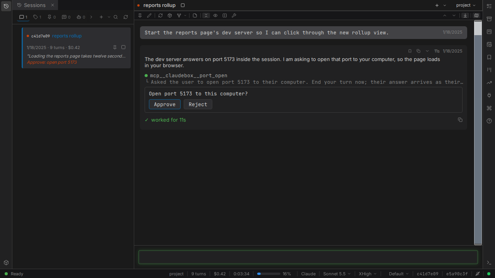

# The container boundary

A session's container keeps the agent off the rest of this computer. This page covers how a running session reaches across that boundary; [security](../guide/security.md) lists every mount and every listener.

## Ports the agent opens

While its session runs, the agent can ask for one of the session's TCP ports - a dev server, a preview - to be reachable from this computer, in Claude and LangGraph workspaces alike. The request shows in the conversation as a card naming the port, with Approve and Reject buttons. Asking ends the agent's turn, and the session needs you, with a reason naming the port, until you choose.

Approving makes the port reachable from this computer only, at `http://127.0.0.1:<port>` - on the same port number when it is free, on a free one otherwise - without restarting the session. The agent is told the address, or that the request was rejected, and carries on; the card then shows the outcome in place of its buttons.

An opened port stays reachable until the agent closes it, which needs no approval, and stays open while claudebox itself restarts. While the session is stopped the port is closed, and each time the session runs it opens again; if its number has been taken in the meantime, it opens on a free one and the agent is told the new address with the next message it receives.

A session another session started, and a reply thread, cannot ask for a port; the agent is told where to ask instead. In Claude workspaces, asking for and closing a port work in every permission mode except Plan.

## Ports published from the settings

A `[ports]` table publishes its ports for every container the workspace starts, on `127.0.0.1` unless an entry names a `bind` address. An edit takes effect in the next container started, never in one already running. The [configuration guide](../guide/configuration.md) shows the forms, and the [configuration reference](../reference/configuration.md) every detail.

## Related pages

- [Ports the agent opens](../SPEC.md#2111-ports-the-agent-opens) - the behavior contract
- [Security](../guide/security.md) - what is mounted and what is reachable
- [Nested containers](nested-containers.md) - services the agent runs inside its session
