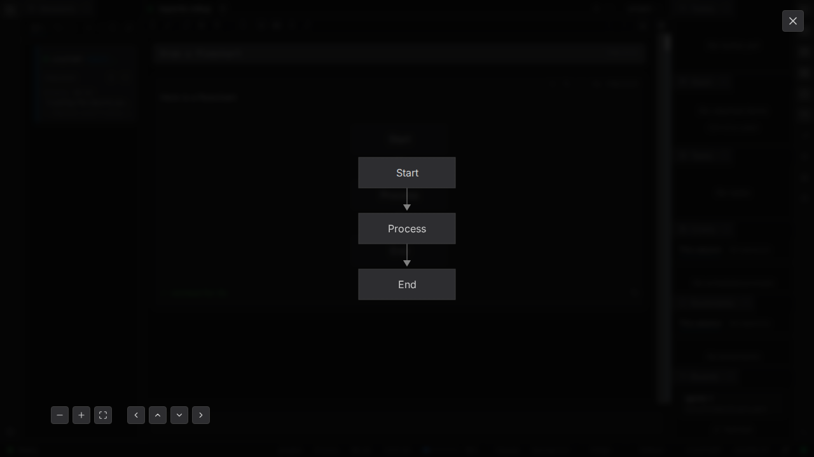
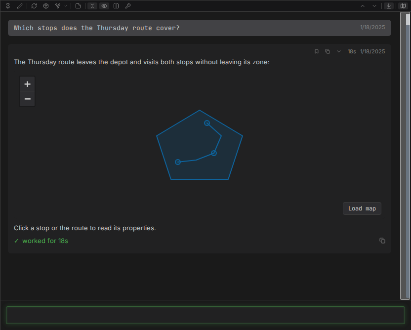
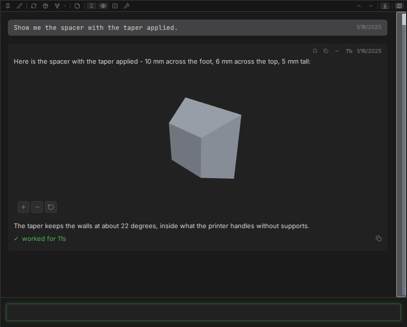

# Diagrams, maps and models

Three kinds of fenced block draw as pictures instead of code: Mermaid diagrams, GeoJSON and TopoJSON maps, and ASCII STL models. Each one carries a toggle back to its highlighted source and a copy button that takes the raw source, and one that cannot be drawn says so, in a notice above its own source naming the reason - rather than vanishing or leaving a blank frame.

## Diagrams

A ` ```mermaid ` fence renders as a diagram - whatever diagram types the bundled Mermaid supports, which is most of what [Mermaid](https://mermaid.js.org/) documents - drawn in the same typeface as the conversation.

- Clicking a diagram opens it in a zoom and pan overlay, showing the whole diagram at its natural size rather than stretched to fill.
- Zoom, fit and directional controls sit in the overlay's corner. `+`, `-` and the arrow keys do the same, the wheel zooms about the pointer, and dragging pans.



## Maps

A ` ```geojson ` or ` ```topojson ` fence draws its shapes on a map fitted to them. The map starts on a plain background and asks nothing of any server until its **Load map** button is pressed, which adds OpenStreetMap tiles to that one map. Its controls, a double-click or a pinch zoom it, dragging pans, and clicking a shape shows its properties; the wheel keeps scrolling the conversation.



## 3D models

A ` ```stl ` fence holding an ASCII STL model draws as a shaded model fitted to the view. Dragging rotates it, right-drag or `Shift`-drag pans, and its controls or a pinch zoom it; a reset control returns to the opening view. It draws in the browser alone, with no request to any server.



## Related pages

- [Mermaid diagrams](../SPEC.md#314-mermaid-diagrams), [maps](../SPEC.md#3141-maps), [3D models](../SPEC.md#3142-3d-models) - the full behavior contract
- [Rendering](rendering.md) - markdown, math, callouts, links and diffs
