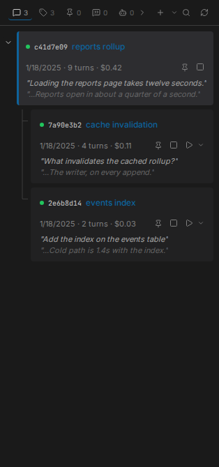
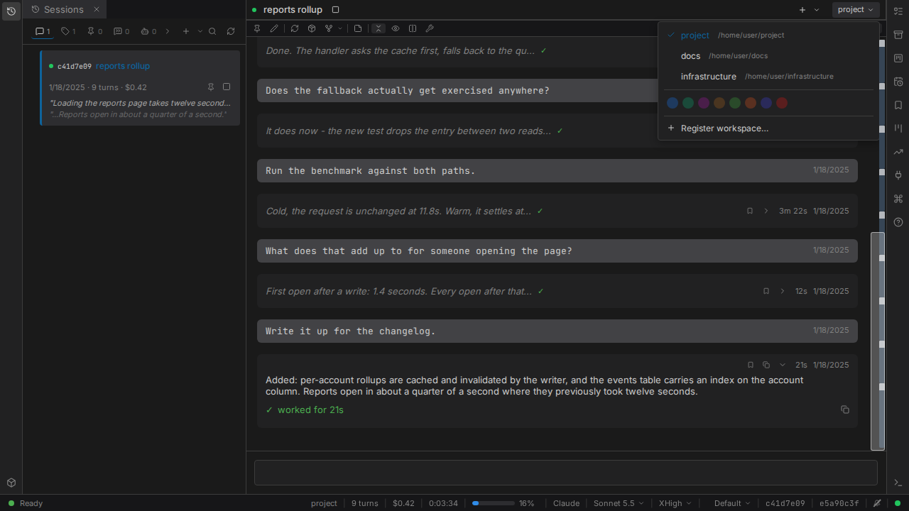
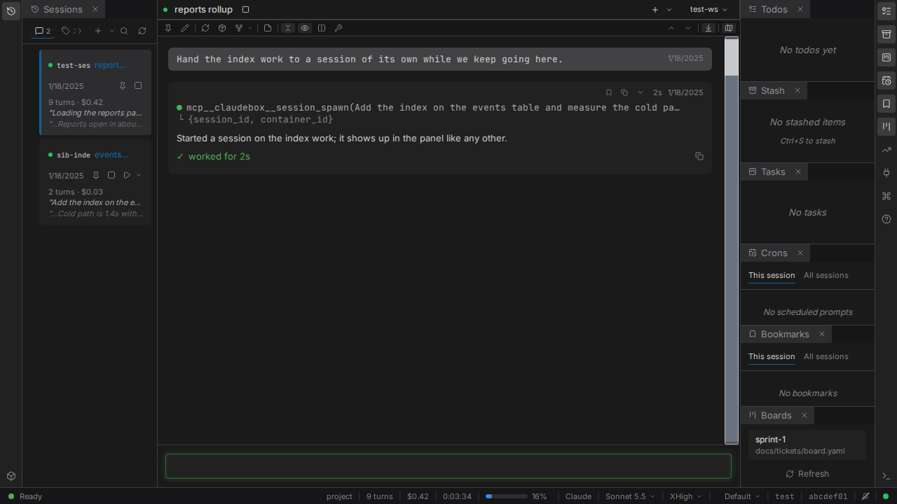

# Many sessions at once

Several sessions run at once, each in its own container, started by the user or by an agent.

## One container per session

Creating a session, resuming a stopped one or forking it into a new browser tab starts a container of its own, and it runs until the session is stopped - closing the browser tab leaves it running. A reply asked on its own and a side conversation join the container of the conversation they came from, and Fork here keeps the current one. Sessions in the same workspace share the workspace directory - mounted at the same path inside the container as outside - their session data and their login, and they reach each other's containers over the workspace's network; [security](../guide/security.md) covers what that allows.

Because the container is the unit, stopping a session stops its container and every thread asked from it, and leaves every other session running; a session whose container is gone still shows its history.

## Several workspaces

With a second workspace registered, the switcher lists them. Sessions, containers and interface state are kept separate per workspace, and switching between them takes one click. Registering and deregistering both happen from that switcher; deregistering removes the registration only, and leaves the `.workspace` marker on disk.

Every session and every board has a URL, so any of it can be bookmarked or shared, and opening a link to a session in another workspace switches workspace on the way.

## Sessions started by an agent

An agent can hand a piece of work to a second session, send it messages, stop it and read its transcript, the same way in Claude and LangGraph workspaces. Handing work over or sending a message never holds up the agent's own turn.

A session an agent starts is an ordinary session. As soon as the agent starts it, it appears as a row in the Sessions panel and as a container in the Containers panel. It can be opened in a tab to read along, or taken over, while the session that started it keeps running. The agent can give it a name, a model and an effort level; it runs under the settings bundle of the session that started it. Under LangGraph, a model or effort level the runtime cannot set stays at its default, and the agent is told which.

Each time the second session finishes a turn, everything it wrote in that turn arrives in the first session's conversation under the second session's name, set apart from your own messages, and the agent carries on from it. While the first session is stopped, those replies wait and arrive just ahead of the next message it receives.

The second session is told which session started it and that only that session reads what it writes. When it needs an answer it ends its turn with the question, which reaches the first session as a reply. It never shows as needing you, and a message arriving from it neither marks the first session as needing you nor clears that mark. A turn such a message starts shows no desktop notification and plays no chime when it ends, unless that turn asks you something.

The agent can list the sessions it started, each as working, idle or stopped, and stop one: it stays in the Sessions panel as stopped and can be resumed, and every session it started stops with it. A stop is refused, naming the thread, while a reply thread you opened runs in a session it would reach. A message to a stopped session it started resumes that session first. The agent can message and stop only the sessions it started, and read any session's transcript. In Claude workspaces, reading and listing work in every permission mode; starting, messaging and stopping follow the session's permission mode.

If the second session was started from inside the conversation in view, it also appears beside it on the [session rail](threads.md), so both are on screen at once.

Spawning is depth-capped. An agent that reaches the cap gets an error naming the cap and the depth it reached, so it stops rather than retrying. The same bound applies to LangGraph's own in-process sub-agents, which run to completion and report back as a tool result rather than becoming sessions.

## Related pages

- [Sibling sessions](../SPEC.md#24-multi-runtime-support) - the behavior contract
- [Workspaces and containers](../SPEC.md#21-workspaces--containers)
- [Threads](threads.md) - the session rail
- [Workspaces guide](../guide/workspaces.md) - markers, registration and storage
