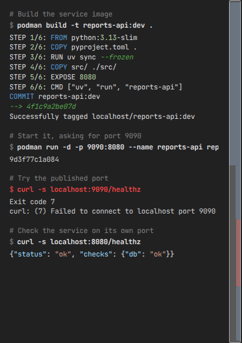

# Nested containers

With nested containers on, an agent builds images and runs services inside its session container, and so tests its work end to end, without being granted anything on the host.

It is off unless a workspace asks for it:

```toml
[containers]
nested = true
```

With it on, the agent has `podman`, `buildah`, `podman-compose` and a `docker` compatibility wrapper. Containers it starts run inside the session container's own namespaces - no `--privileged` anywhere, invisible to the host and to every other session, and removed when the session ends. Their storage is in-memory and capped, so image layers an inner build produces do not outlive the session either.



## Constraints

The toolchain shares the session container's network namespace rather than taking one of its own. Every limit below follows from it. Only the first is silent; the rest fail loudly.

| Constraint | What happens |
|---|---|
| Inner containers cannot publish ports | `-p` is accepted and has no effect - nothing is listening afterwards |
| Ports below 1024 are unavailable | Binding one fails |
| User-defined networks cannot be created | Creating one needs a capability the session container does not hold |
| `podman-compose` services need `network_mode: host` | Without it services cannot reach each other; with it they reach each other on `localhost` |

A service an inner container runs is reachable on `localhost` from inside the session container, which is where the agent already is. Nothing needs publishing for the agent's own use of it; to reach it from this computer, the agent asks to open its port - see [the container boundary](container-boundary.md).

## Network mode and isolation

Inner containers are separated from the host network only because the session container holds a private network namespace of its own. A workspace that gives that up:

```toml
[network]
mode = "host"
```

puts a `claudebox run` or `claudebox shell` session container on the host network, and every container the agent starts inside it along with them; a session in the browser refuses to start under it.

## Related pages

- [Specification](../SPEC.md#219-nested-containers) - the behavior contract
- [Configuration reference](../reference/configuration.md) - every key, including `[containers]` and `[network]`
