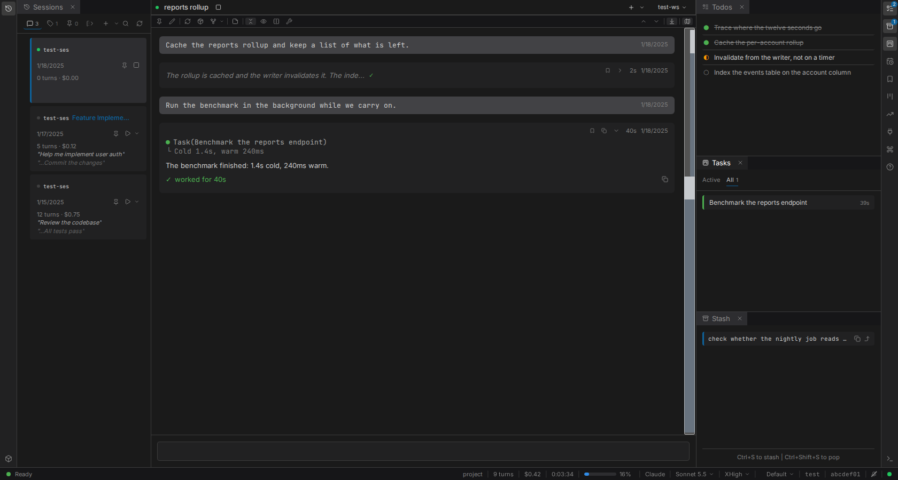
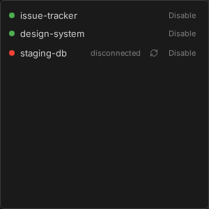
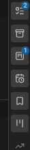

# Panels

The chat is one panel among several. The others show what an agent plans to do, what it has spawned and what it is spending, outside the transcript.

Panels dock around the chat and toggle from icon strips on either edge. Chat itself cannot be closed. Everything else can be dragged, resized, maximized by double-clicking its tab, and closed by middle-clicking it. Each panel reopens at the width it last had, and the whole arrangement is saved as it changes and restored on load - a new session inherits the layout of the last one.

Hovering an icon whose panel is closed opens it as a floating preview.

## Panels and their keys

| Panel | Key | What it holds |
|---|---|---|
| Sessions | `Alt+1` | Every session in the workspace as a tree, forks nested under what they forked from. Create, resume, rename, pin. A row's dot turns purple while its agent works, a dimmer purple while background work it started runs, and dark orange while it needs you. An unnamed session titles itself after its third message, again at the sixth and tenth, shown in italics until it is named |
| Todos | `Alt+2` | The agent's current task list, live, grouped by the subagent that created it |
| Stash | `Alt+3` | A scratch clipboard for prompts. `Ctrl+S` stashes the typed text, `Ctrl+Shift+S` pops it back |
| Tasks | `Alt+4` | Background subagents and shell commands the agent has started, with live duration. Clicking one lands on its block |
| Crons | `Alt+5` | Prompts the agent has scheduled for itself, in this session or across every running one, soonest first, with when each fires next. Clicking one lands on the call that scheduled it |
| Bookmarks | `Alt+6` | Bookmarked turns, single paragraphs and tool calls, in this session or across all of them, synced between browser tabs |
| Boards | `Alt+7` | Ticket boards discovered in the workspace |
| Usage | `Alt+8` | Cost over 24 hours, 7 days, 30 days and all time |
| MCP Servers | `Alt+9` | Connection state per server, with reconnect and disable controls |
| Skills | | The slash commands available to the agent, split into custom, MCP and all |
| Logs | `Alt+0` | The log stream of the session in view, its latest thousand entries |
| Help | `Alt+?` | The keyboard reference, as an overlay |
| Containers | | The workspace's containers in every state, each named by its session, with stop and resume controls |

`Alt+C` returns focus to the chat.

## Badges

Some icons carry a count, hidden while that count is zero.

- **Todos** shows how many items are still incomplete.
- **Stash** shows how many entries are waiting, and nothing when it is empty.
- **Tasks** shows how many background tasks are running right now.
- **Crons** shows how many scheduled prompts are still active.
- **MCP Servers** shows how many servers have failed, in red.

## Related pages

- [Layout and panel behavior](../SPEC.md#1-layout)
- [Sessions panel](../SPEC.md#5-sessions-panel), [Boards](../SPEC.md#6-boards-panel--ticket-board), [Tasks](../SPEC.md#16-tasks-panel), [Crons](../SPEC.md#17-crons-panel), [Usage](../SPEC.md#18-usage-panel)
- [Keyboard shortcuts](../reference/shortcuts.md)
