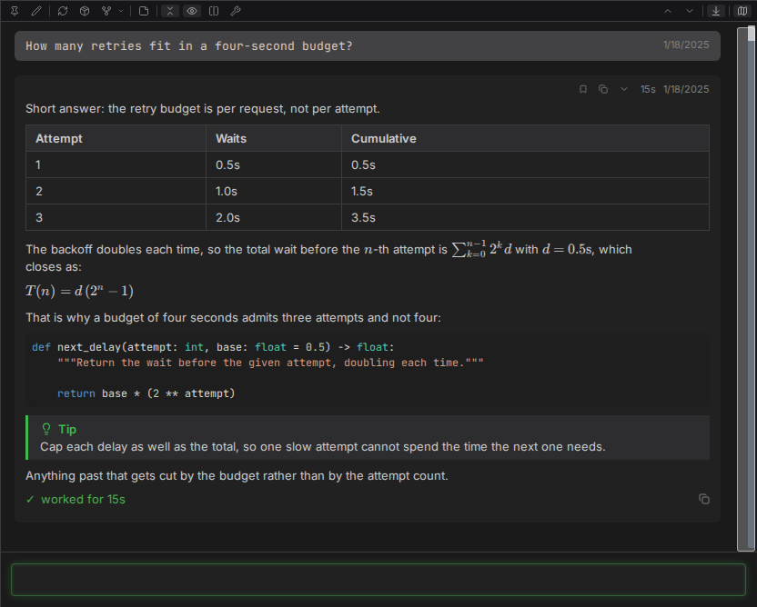
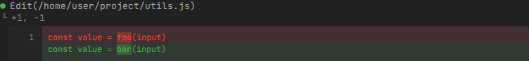

# Rendering

An agent that can only emit plain text has to describe its diagram to you. Claudebox draws it. The chat is a full document surface, so the answer arrives in whatever shape the answer actually has.

This page covers text, links and diffs; [diagrams, maps and 3D models](diagrams.md) have a page of their own.

## Text

Replies render as GitHub-flavored markdown: headings at all six levels, lists, tables, task lists, block quotes, strikethrough, footnotes. Inline and fenced code is syntax-highlighted, by file extension where the content names one and by detection where it does not. LaTeX math renders through KaTeX, inline and display; inline math may also be written GitHub's way, as `` $`x^2`$ ``, which lets a formula hold a `$`.

A quote that opens with `[!NOTE]`, `[!TIP]`, `[!IMPORTANT]`, `[!WARNING]` or `[!CAUTION]` on its own line appears as a callout, the way GitHub draws one: an edge and a header in that kind's colour, the header carrying its icon and name. Inline code holding a colour value and nothing else - `#0969DA`, `rgb(9, 105, 218)`, `hsl(212, 92%, 45%)` - shows a swatch of that colour after it.

Markdown-shaped tool output renders as formatted text rather than raw source, and hovering it reveals a toggle that switches back to the highlighted source, plus a copy button that takes the raw markdown.

Messages may also carry common inline and block HTML - collapsible sections, keyboard keys, definition lists, figures, tables with merged cells - and it appears as real formatting. What cannot appear is anything that would execute: scripts, inline event handlers, `javascript:` links, embedded frames and standalone vector graphics are stripped before the message is drawn.

## Diffs

An edit shows as a diff, and consecutive changed lines are compared word by word so you see the characters that moved rather than two whole lines painted red and green. Unpaired additions and removals highlight whole-line.

## Paths, links and images

File paths in tool output, messages and code blocks resolve against the workspace and become clickable. Clicking copies the absolute path. With an editor configured, `Alt`-clicking opens the file there instead - at the right line when the tool knew one. Configure it with `[editor] url_template`; without it, `Alt`-click just copies.

A relative link or image resolves against wherever its text came from. In the agent's own replies and in markdown a command prints, `[the guide](docs/guide.md)` is a path into the directory the agent works in - hovering shows it in full, clicking copies it, `Alt`-click opens it - and `` displays that file, in a stopped session too; an image under `/tmp` comes from the session's own temp directory. A markdown file shown in a tool result resolves against its own folder, a skill's instructions against the skill's folder, and a page fetched from the web against that page's address, so its links open the neighbouring page and its images load from that site. A link that would lead outside its directory, or that has nothing to resolve against - web search results, a ticket's details, a tool server's output - shows as plain text; such an image shows as an unloadable image with its description.

A link to another part of the same message - a footnote, a heading, a named anchor - scrolls to that part and highlights it, in the same tab.

## Details

- [Message display](../SPEC.md#31-message-display) - markdown, HTML, links, images and safety
- [Edit diff display](../SPEC.md#4111-edit-diff-display)
- [File path display](../SPEC.md#421-file-path-display)
- [Configuration reference](../reference/configuration.md) - `[editor] url_template`
- [Diagrams, maps and models](diagrams.md)
