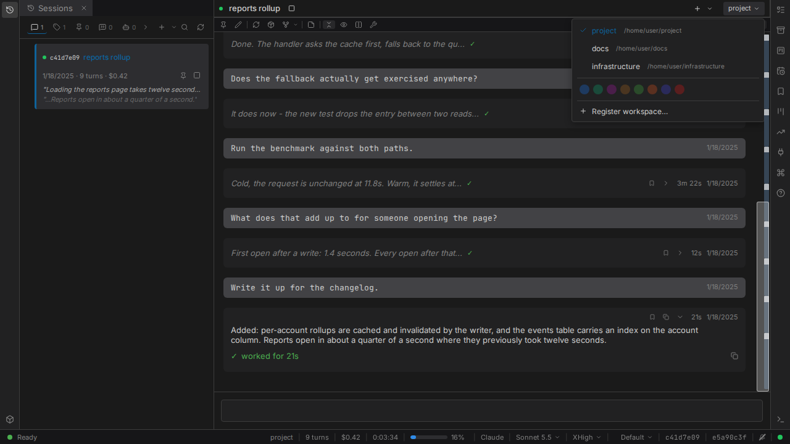

# Working across workspaces

Claudebox runs unscoped by default: one pool of sessions, credentials and interface state under `~/.claudebox/`, so with two projects, one project's sessions are in the other's list.

A workspace, marked by a file, keeps a project's sessions apart.

## Scoping a project

```bash
touch .workspace
```

From then on, everything for that project lives under `{project}/.claudebox/` instead of the home directory - sessions, credentials, interface state. Nothing crosses between workspaces.

The marker is the whole mechanism. Claudebox walks up from the working directory looking for it, and where it finds one, that directory is the root.

## Registering a workspace

A marker scopes storage. Registering is what puts the workspace in the web interface:

```bash
claudebox workspaces register        # the workspace of the working directory
claudebox workspaces list
claudebox workspaces deregister <id>
```

The browser registers one too, through the workspace switcher's "Register workspace" item, and deregisters a workspace from the trash control on its row. Either way of registering writes the `.workspace` marker if the directory has none; the browser takes an absolute path, or one starting with `~`, to a directory that exists, and says why it refuses anything else. The home directory, a directory above it and Claudebox's own folder are registered from a terminal only: run `claudebox workspaces register <path>` for the path, and the browser's Register item refuses them until you have. Deregistering removes the registration only - the `.workspace` marker and everything under `.claudebox/` stay.

The switcher itself is always there. With one workspace it offers the accent-color palette; once a second is registered it also lists the workspaces, with the active one marked.



## The id in the URL

A workspace's id is its directory name. Two projects with the same directory name would collide, so the second one to register gets an eight-character hash of its absolute path appended - `api` and `api-3f2b9c41`. That is why an id sometimes carries a suffix and usually does not.

## What lands where

Relative to whichever root is active - the workspace directory, or the home directory when there is no marker:

| Path | Contents |
|---|---|
| `.claudebox/settings.toml` | Settings for this scope |
| `.claudebox/sessions/` | One directory per session: events, logs, per-session state |
| `.claudebox/fs/root/.claude.json` | The agent's own settings file, mounted into the container |
| `.claudebox/fs/root/.claude/` | The agent's configuration directory, its login (`.credentials.json`) included |

The login file is as sensitive as any other API token.

## Links

Every view has a URL, so anything on screen can be bookmarked or shared.

| Hash | Opens |
|---|---|
| `#/workspaces/{id}` | The workspace, no session |
| `#/workspaces/{id}/sessions/{sid}` | A session, scrolled to its latest message |
| `#/workspaces/{id}/sessions/{sid}/turns/u-{tid}` | A session, paused at a human message |
| `#/workspaces/{id}/sessions/{sid}/turns/a-{tid}` | A session, paused at an assistant message |
| `#/workspaces/{id}/boards/{bid}` | A board |
| `#/workspaces/{id}?send={text}` | A new session that sends the text. Repeating `send` carries several messages: the first is sent and the rest wait in the message queue. Text sends only when every piece matches a `[links] allow` pattern; otherwise it waits in the message box |

Opening a link into a workspace other than the current one switches workspace on the way.

## Related pages

- [Workspaces and containers](../SPEC.md#21-workspaces--containers) - the behavior contract
- [Configuration guide](configuration.md) - where settings files are read from
- [Many sessions](../features/multi-session.md)
